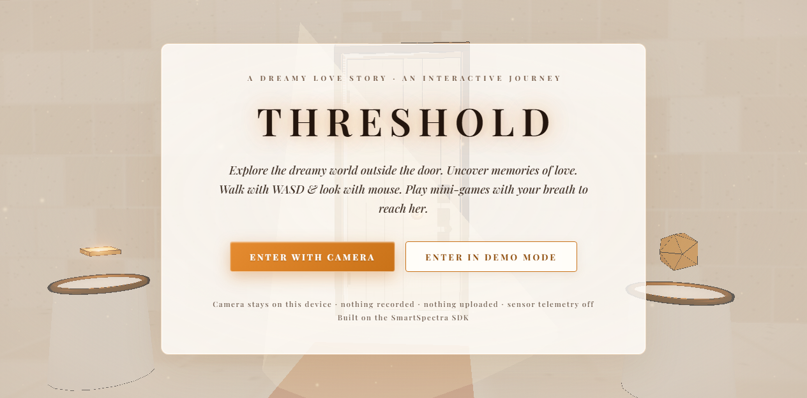
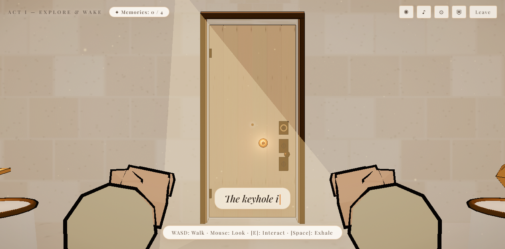
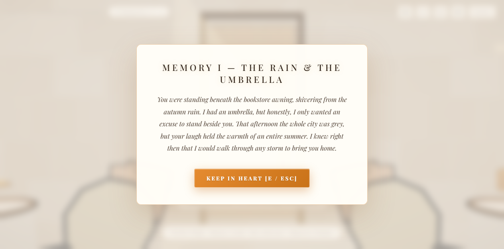
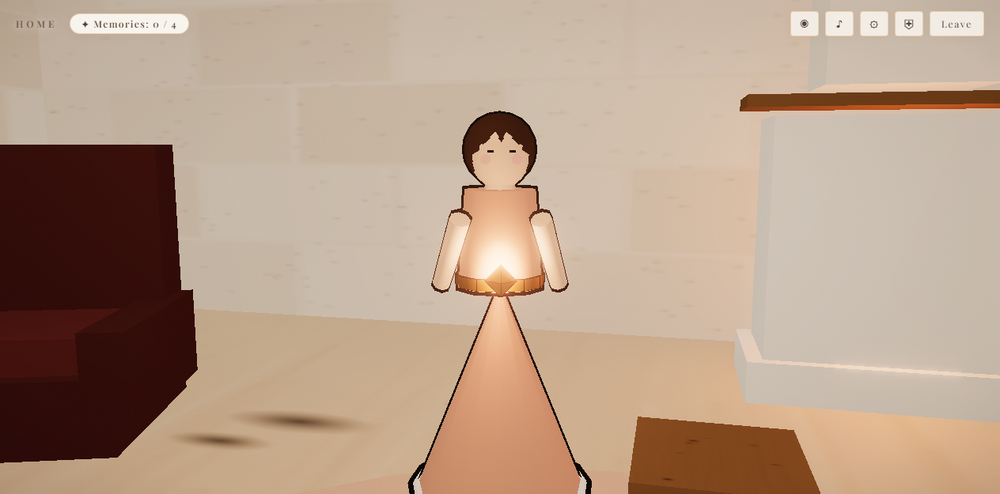

# THRESHOLD (門檻)

> **"Leave the workday at the door. Your breath is the key to her world."**  
> *A 3D first-person atmospheric transition ritual and love story powered by Three.js and the Presage SmartSpectra SDK.*

---

## 📸 Visual Showcase

<div align="center">

| Title Screen | First-Person Courtyard |
| :---: | :---: |
|  |  |

| Memory of Love Modal | The Sanctuary Reunion |
| :---: | :---: |
|  |  |

</div>

---

## 🌟 The Experience

Every evening after a demanding workday, we carry lingering tension, rapid heartbeats, and stress in our shoulders. Too often, we bring that chaotic storm directly across the threshold into the sanctuary of the person waiting for us.

**Threshold** is an interactive, cel-shaded, first-person emotional transition ritual. Standing outside the doorway of your home in a serene dream world, you cannot force the door open with speed or force. 

You must explore, reflect, and slow your body down. Your actual arterial heartbeat—measured contactless via your webcam—pulses through the door’s brass keyhole. Only by taking **three deep, deliberate, calming breaths** will the three heavy mechanical brass locks disengage, opening the door to reunite with the girl waiting by the fireplace with tea and a warm lantern.

---

## ✨ Key Features

- **🎮 Full First-Person Immersion (`WASD` + Mouse)**:
  - Walk freely through a cel-shaded courtyard with ground collision, bobbing, and pointer-lock mouse camera look.
  - Expressive first-person hands and charcoal coat sleeves rendered in an ink-bordered comic/anime art style.
- **📜 Four Memories of Love**:
  - Discover 4 interactive pedestal beacons scattered across the courtyard:
    - *Memory I — The Rain & The Umbrella*
    - *Memory II — The Late Train*
    - *Memory III — The Burnt Toast*
    - *Memory IV — The Quiet Sunday*
- **🪨 Tactile Mindful Mini-Games**:
  - *The Resonant Bell*: Strike and hold the hammer, releasing on exhale to ring harmonic chords.
  - *The Wind Spinner*: A delicate kinetic compass reacting to breath flow.
  - *Zen Stone Stacking*: Calibrate stillness and balance floating cobblestones.
- **🫀 Live Biometric Keyhole**:
  - The brass keyhole physically expands, glows, and illuminates the room in lockstep with your real systolic blood volume pulse (BVP) trace.
- **🌬️ Exhale-Driven Locks**:
  - Three heavy brass lock cylinders rotate and click open only through three sustained, calming exhalations ($> 3.5\text{s}$ each).
- **🎶 Pure Procedural Soundscapes**:
  - Zero external MP3 downloads—100% procedurally synthesized audio using the Web Audio API (singing bowls, binaural ambient pads, acoustic chimes, mechanical tumbler clicks).
- **🛡️ 100% Privacy-First & Zero Retention**:
  - Video stream stays strictly on-device in browser memory; SmartSpectra SDK telemetry is disabled (`telemetry: false`); zero analytics, zero cookies, zero data storage.

---

## 🛠️ Technical Stack & Architecture

```
┌─────────────────────────────────────────────────────────────┐
│                       Client Browser                        │
│  Three.js (WebGL 2.0)  │  Web Audio API  │  PointerLock API │
│  Cel-Shading Outlines  │  Ring Buffers   │  DOM HUD Layer   │
└───────────────▲─────────────────────────────▲───────────────┘
                │                             │
    Webcam Video Stream (Local)       WebSocket (JSON / Binary)
                │                             │
┌───────────────▼─────────────────────────────▼───────────────┐
│                    Local Node.js Server                     │
│  Express 5.3 (Static Assets)  │  ws 8.23 (Local Bridge)     │
│  Presage SmartSpectra SDK     │  Physiological Simulator    │
└─────────────────────────────────────────────────────────────┘
```

### 1. Rendering Engine (Three.js WebGL 2.0)
- **Cel-Shading & Ink Outlines**: Custom edge geometries with GPU depth biasing (`polygonOffsetFactor: -2.0, polygonOffsetUnits: -4.0`) to eliminate polygon Z-fighting and line jitter.
- **Atmospheric Lighting**: Directional dream light shaft, floating ambient dust motes (`fx.js`), procedural wood and stone canvas textures (`textures.js`), and subtle UnrealBloom post-processing.
- **CAD-Snapped Architecture**: Seamless facade and doorway construction with exact tolerances between wall cutouts, timber jambs, gilded arch pillars, and door seals.

### 2. Physiological Sensing (Presage SmartSpectra SDK)
- **Remote Photoplethysmography (rPPG)**: Contactless extraction of blood volume pulse (`pulse.waveform`) and heart rate (`pulse.rate`) from facial micro-color variations.
- **Respiratory Dynamics**: Real-time chest wall excursion tracking (`metrics.breath.waveform` and `metrics.breath.rate`) detecting inhale/exhale cycles.
- **Facial Landmark Tracking**: 68 facial points ensuring player framing and distance calibration.

### 3. Audio & Synthesis
- **Web Audio API Engine (`client/js/audio.js`)**: Procedural frequency modulation oscillators, resonant biquad filters, harmonic chord progressions, and procedural haptic clicks.

---

## 🚀 Getting Started

### Prerequisites
- **Node.js**: v18.0.0 or higher (v20+ recommended)
- **Modern Web Browser**: Chrome, Edge, Firefox, or Safari (WebGL 2.0 & WebSocket enabled)
- **Webcam**: Required for live biometric sensing (or use the built-in Demo Mode)

### Installation

1. **Clone the repository**:
   ```bash
   git clone https://github.com/hkhearts/Threshold-Hubby-Game.git
   cd Threshold-Hubby-Game
   ```

2. **Install dependencies**:
   ```bash
   npm install
   ```

3. **Configure Environment (Optional)**:
   If you have a Presage SmartSpectra API key for live optical sensing:
   ```bash
   cp .env.example .env
   # Add your key to .env:
   # SMARTSPECTRA_API_KEY=your_key_here
   ```
   > *Note: If no API key or webcam is configured, the application automatically runs in **Demo Mode**, utilizing a high-fidelity synthetic physiological simulator (`server/simulator.mjs`).*

4. **Start the game**:
   ```bash
   npm start
   ```
   Open **`http://localhost:4310`** in your browser.

---

## 🎮 Controls

| Action | Control | Description |
| :--- | :--- | :--- |
| **Walk** | `W` `A` `S` `D` | Explore the courtyard in first-person |
| **Look** | `Mouse` | Pan camera (click screen to engage Pointer Lock) |
| **Interact** | `E` | Read memories, trigger pedestals, strike mini-game items |
| **Exhale / Breathe** | `Space` *(Demo)* / `Breathe out` *(Camera)* | Turn the 3 brass locks with long exhalations |
| **Framing Silhouette**| `S` | Toggle facial alignment guide overlay |
| **Mute Sound** | `M` | Toggle audio synthesizer |
| **Debug Overlay** | `D` | Inspect live signals, frame rates, and force state transitions |
| **Leave / Erase** | `Leave` button | Immediately kill camera tracks, erase buffers, and exit |

---

## 🧪 Testing & Verification

Threshold comes with a production-grade automated test harness:

```bash
npm test
```

This single command executes three rigorous verification stages:
1. **`npm run check`**: Runs Node.js syntax checks (`node --check`) across all 25 client and server ES modules.
2. **`node scripts/probe.mjs`**: Executes 17 backend and signal integrity probes (HTTP static assets, Three.js vendor scripts, WebSocket handshake, rPPG packet parsing, breath oscillator tests).
3. **`node scripts/test-client.mjs`**: Launches a headless Chrome browser via Chrome DevTools Protocol (CDP), simulates user gameplay through Act I, Act II, Act III cutscene, and verifies 0 console errors or exceptions.

---

## 🔒 Privacy, Ethics & Consent

Threshold is built on an uncompromising commitment to user privacy:

- **Explicit Informed Consent**: Before the webcam is ever initialized, a mandatory full-screen modal explains precisely what data is sensed and provides a one-click **"Enter in Demo Mode"** alternative.
- **Local-Only Processing**: All video frame ingestion and optical analysis occur exclusively in local memory (`127.0.0.1`).
- **Telemetry Off**: SmartSpectra background telemetry is explicitly disabled (`telemetry: false`).
- **Zero Retention**: No video, images, or sensor metrics are ever recorded, cached, stored, or transmitted over the internet.
- **Medical Disclaimer**: Threshold is a mindfulness game and wellness ritual. It does not provide diagnosis, treatment, prognosis, or medical monitoring.

---

## 📂 Project Structure

```
├── client/
│   ├── index.html              # HTML shell & UI overlays
│   ├── styles.css              # Light-mode dreamy aesthetics, typography & animations
│   └── js/
│       ├── main.js             # Game lifecycle, scene coordinator & render loop
│       ├── net.js              # WebSocket telemetry client & reconnect logic
│       ├── framepump.js        # Webcam frame ingestion & rate limiter
│       ├── signals.js          # Ring buffers, physiological smoothing & filters
│       ├── audio.js            # Procedural Web Audio API sound generator
│       ├── game/
│       │   ├── cutscenes.js    # Camera director & act state machine
│       │   ├── locks.js        # Exhale-driven brass lock mechanics
│       │   ├── interactables.js# Memory beacons & world interaction triggers
│       │   └── minigames.js    # Mindful kinetic mini-games
│       ├── gfx/
│       │   ├── renderer.js     # Three.js renderer, lighting & UnrealBloom
│       │   ├── hallway.js      # Courtyard, portal arch, door & locks geometry
│       │   ├── room.js         # Warm sanctuary room & fireplace geometry
│       │   ├── girl.js         # 3D anime-inspired girl character model
│       │   ├── hands.js        # First-person arms with comic ink borders
│       │   ├── outline.js      # Depth-biased WebGL cel-shading outlines
│       │   ├── fps.js          # First-person WASD & mouse controller
│       │   ├── cam.js          # Camera dolly & cinematic transitions
│       │   ├── fx.js           # Floating motes & atmosphere particles
│       │   └── textures.js     # Procedural canvas textures
│       └── ui/
│           ├── ui.js           # HUD, memory modals, prompts & toasts
│           ├── silhouettes.js  # Face framing guide overlay
│           └── privacy.js      # Privacy disclosures & consent controller
├── server/
│   ├── index.mjs               # Express 5 HTTP server & WebSocket server
│   ├── sdk-bridge.mjs          # Presage SmartSpectra SDK integration
│   └── simulator.mjs           # Synthetic cardiovascular/respiratory generator
├── scripts/
│   ├── probe.mjs               # 17-point backend & signal test suite
│   ├── test-client.mjs         # Headless Chrome E2E browser automation test
│   └── take-gameplay-shots.mjs # Automated screenshot capture script
└── package.json                # Project manifest, scripts & dependencies
```

---

## 📄 License

MIT License. Designed and built with care for the **Presage SmartSpectra SDK Challenge**.
